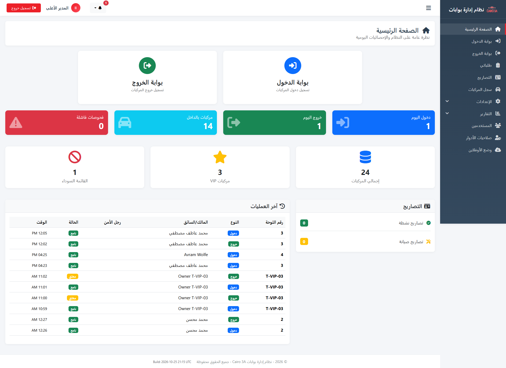
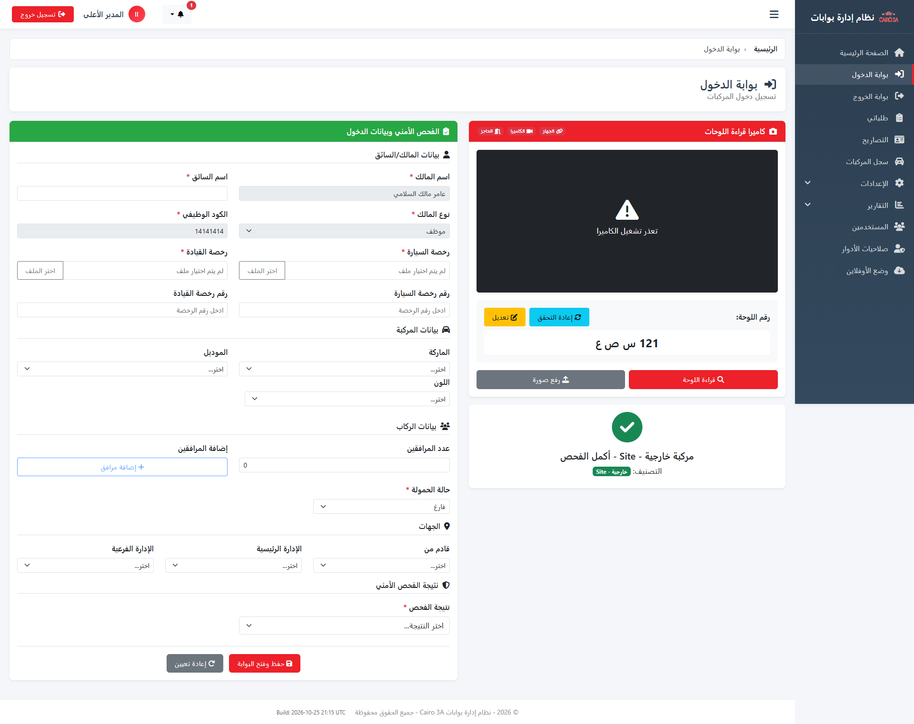
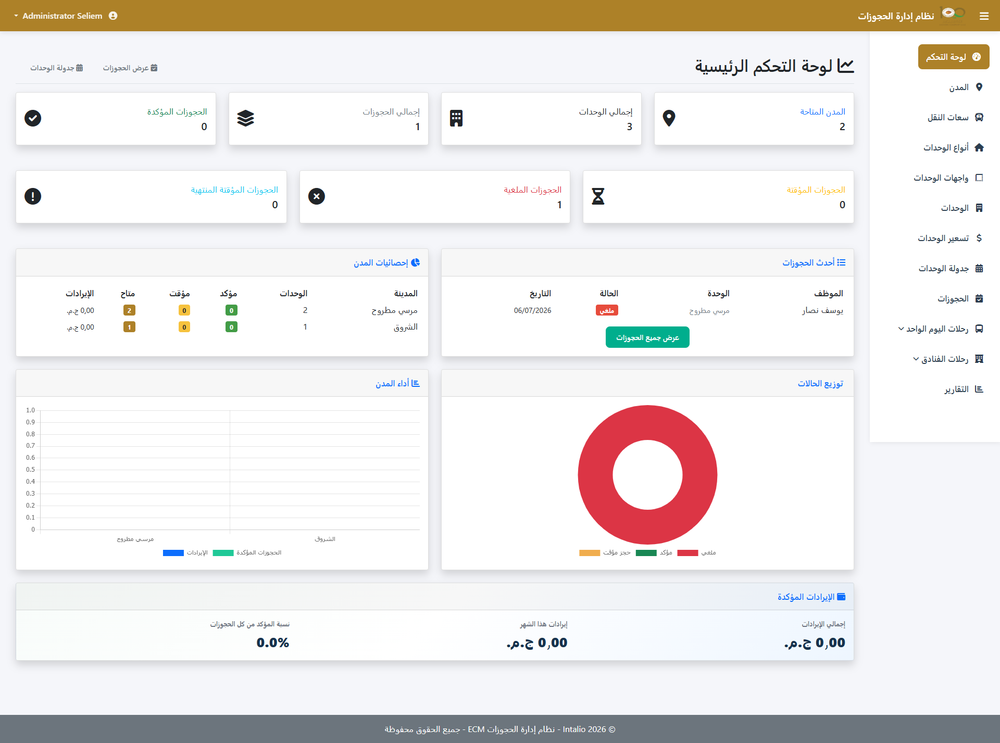
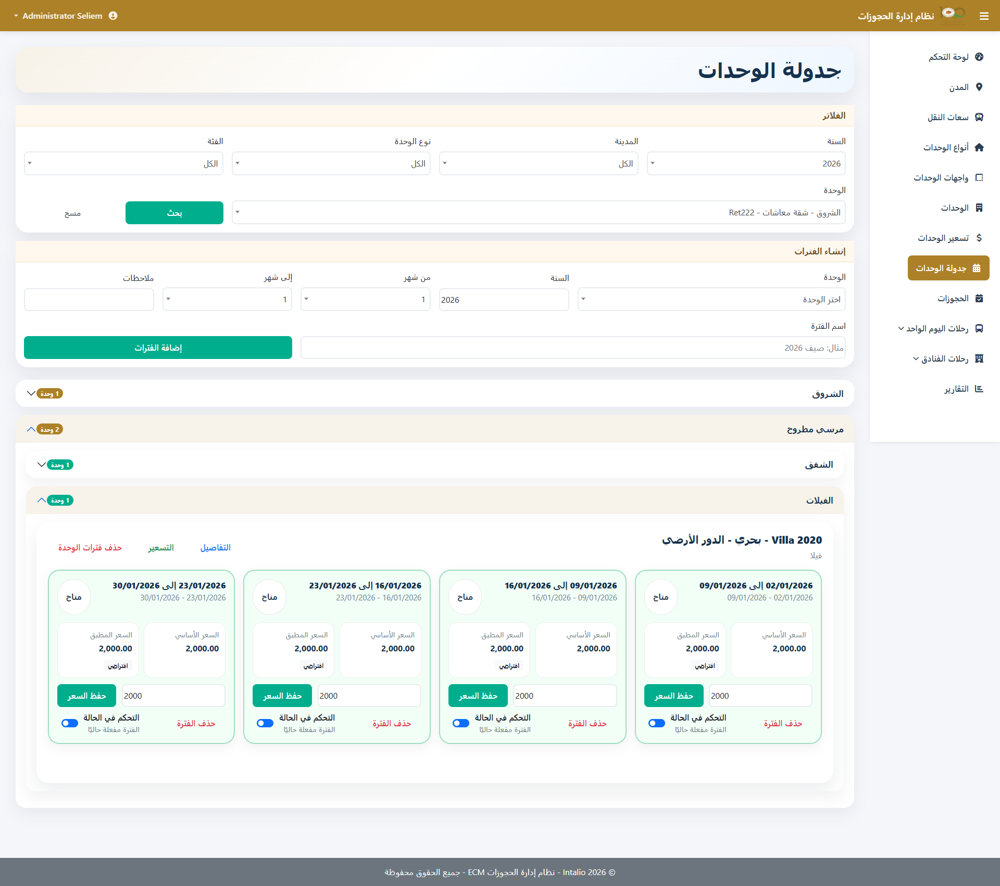
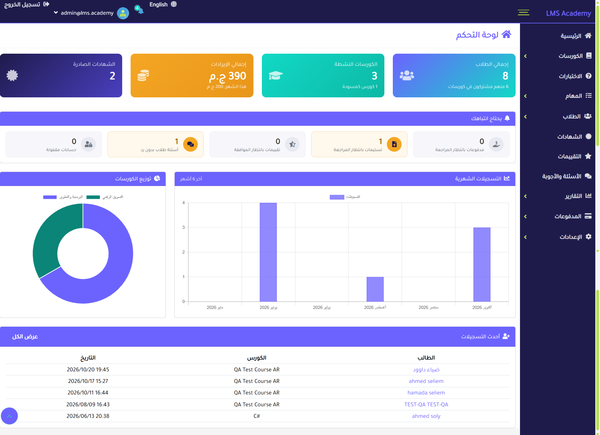
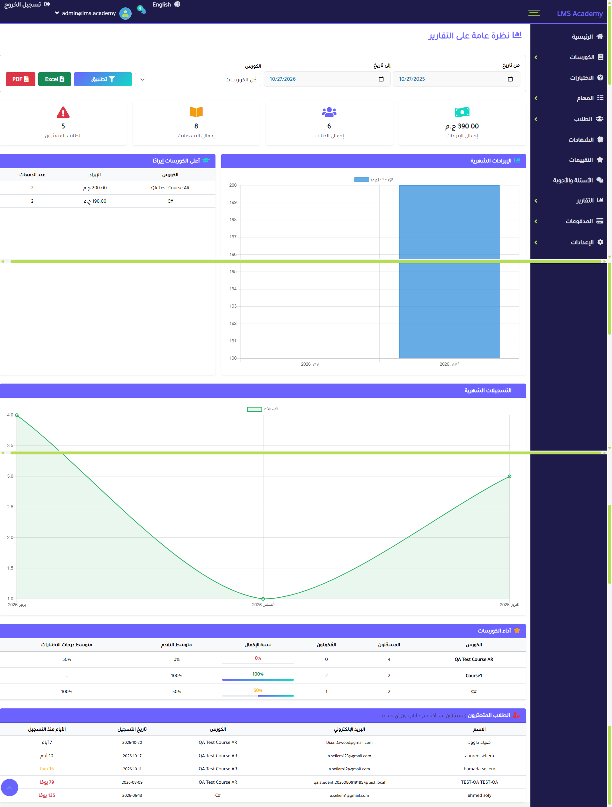
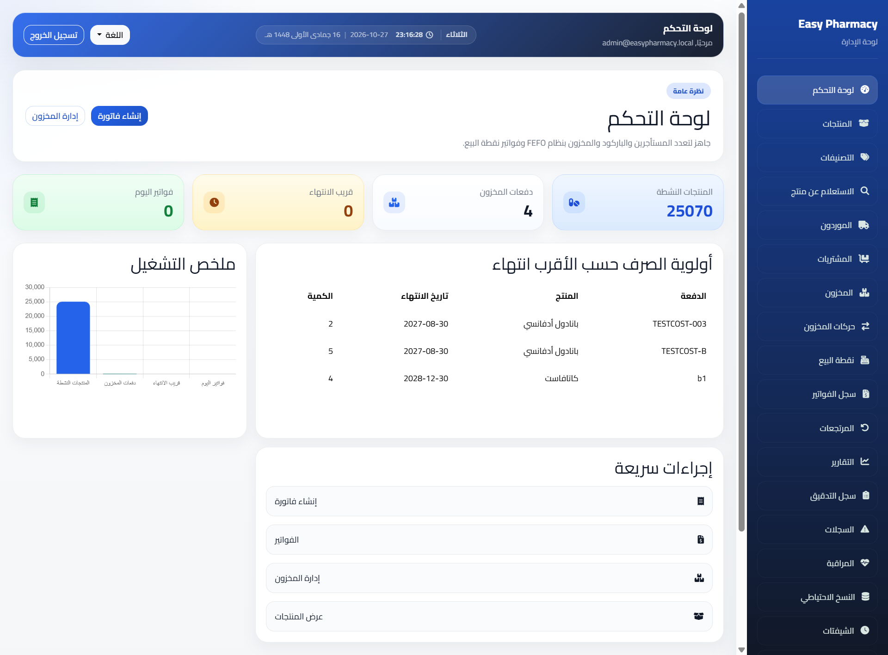
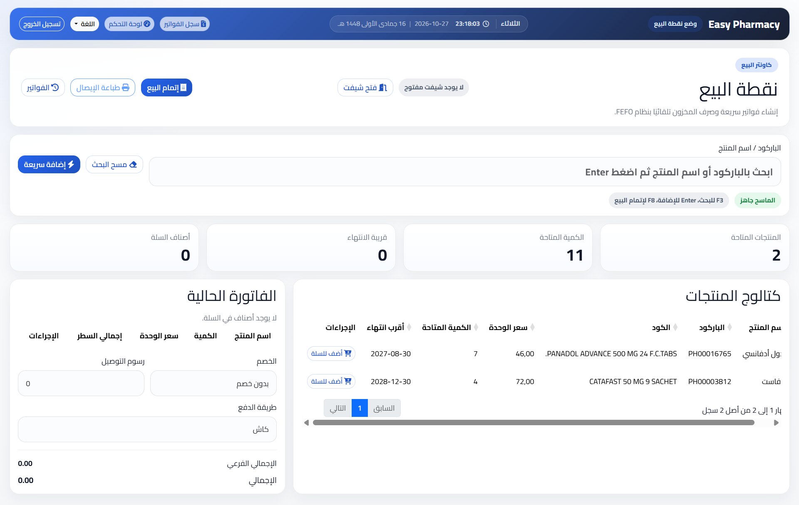

# Hi, I'm Ahmed Seliem 👋

**Full-Stack .NET Developer** with 5+ years of experience building business systems with **ASP.NET Core, Clean Architecture and SQL Server**.
Currently a .NET Developer on the Professional Services team at **EverteamGS (Intalio)**.

I build bilingual **Arabic / English (RTL)** applications: secure role-based platforms, workflow-integrated enterprise systems, offline-first systems with hardware integration, and CMS websites.

---

## 🛠️ Tech Stack

**Backend:**  
C# · .NET 6 / 8 / 9 · ASP.NET Core MVC & Web API · ASP.NET MVC · Web Forms · EF Core · LINQ · MediatR (CQRS) · FluentValidation · AutoMapper · SignalR · Hangfire · Hosted Services · Serilog

**Data:**  
SQL Server (T-SQL, stored procedures, query optimization) · MySQL · Redis

**Frontend:**  
JavaScript · jQuery · Angular · Knockout.js · Form.io · Bootstrap 5 (RTL) · HTML / CSS

**Security & Auth:**  
OpenID Connect · JWT Bearer · ASP.NET Identity · Role & policy-based authorization · CSP · CSRF protection · Rate limiting

**CMS & Workflow:**  
Umbraco 13 · SharePoint (document management, workflows, custom lists) · Intalio CASE (custom workflow activities)

**Architecture:**  
Clean Architecture · Onion Architecture · Repository Pattern · Dependency Injection · REST APIs

**Tools:**  
Visual Studio · Git · GitLab · IIS · Swagger · Postman · Unit Testing · Playwright / Puppeteer

---

## 🚀 Featured projects

> These are client projects, so the source code is private. A demo or walkthrough is available on request.

### 🚧 Cairo 3A Parking Gates: Offline-first vehicle access control
An Arabic-first access control system for an industrial site. ANPR cameras read licence plates, the system checks permits, blacklists and security rules, and the barrier opens under operator control. **Each gate keeps working when the network to the central server goes down.**

**Tech:** ASP.NET Core (.NET 9) MVC + Web API · Clean Architecture · EF Core 9 · SQL Server · Identity + JWT · SignalR · Serilog · Swagger · IIS

<!-- 
 
 -->

<b>Highlights</b>

- **Offline-first distributed design:** every gate is an independent node with its own database; three-phase sync (local queue → server → other nodes) with batching and retries.
- **Cross-node identity:** a stable `GlobalSyncId` per record, with foreign keys translated on ingest so data converges correctly.
- **Arabic/Latin plate matching:** normalisation of Arabic-Indic digits, letter variants and invisible RTL marks, applied in the persistence layer and indexed.
- **Hardware integration:** ANPR cameras and BioStar 2 barrier control behind a clean abstraction; the movement is saved before the open command is sent.
- **Live operator screens** via SignalR, plus permits, VIP and blacklist rules, manager escalation, and per-gate permissions.
- **Reports** exported to Excel and PDF, and a SQL diagnostics toolkit for sync issues.

### 🏖️ ECM Reservation System: Workflow-integrated booking platform
A reservation platform for employees and pensioners covering **summer-resort units, one-day trips and hotel trips**. Requests start in an enterprise workflow, are validated and priced by the system, and are confirmed by admins after payment.

**Tech:** ASP.NET Core (.NET 8) MVC + Web API · Clean Architecture · EF Core 9 · SQL Server · OpenID Connect + JWT (IAM) · Intalio CASE · Form.io · AutoMapper · Serilog

<!-- 
 
 -->

<b>Highlights</b>

- **Workflow integration:** a custom Intalio CASE activity (.NET 6) reads Form.io form data and submits it to the reservation API; the system calls back into CASE to fetch request data and confirm bookings.
- **24-hour reservation hold:** bookings are held until payment is confirmed manually; background hosted services release expired holds and return units and dates to availability.
- **Concurrency-safe booking:** `sp_getapplock` prevents overbooking when two users reserve the last seat at the same moment.
- **Pricing engine:** weekly rent, insurance and optional transportation calculated per booking.
- **Separate quotas and workflows** for employees and pensioners.
- **Single sign-on:** OIDC with cookies for the admin portal and JWT Bearer for the APIs.
- **Admin portal:** cities, units, prices, trips, payment confirmation and reports.

### 🎓 LMS Academy: Arabic-first learning platform
A platform for selling and delivering online courses. Students pay, watch protected video lessons, take quizzes, submit assignments and receive verifiable certificates.

**Tech:** ASP.NET Core 8 MVC · Clean Architecture · CQRS (MediatR) · EF Core 8 · SQL Server · Identity · SignalR · Hangfire · Stripe · QuestPDF · EPPlus

<!-- 
 
 -->

<b>Highlights</b>

- **Protected video streaming:** multi-GB chunked uploads, time-limited signed URLs, AES-CTR encrypted chunks decrypted in the browser, and a moving watermark for leak tracing.
- **Payments:** Stripe checkout plus manual methods (Vodafone Cash, InstaPay, bank transfer) with an admin approval workflow and coupons.
- **Learning flow:** courses → lessons → timed quizzes → graded assignments → Arabic PDF certificates with QR verification.
- **Roles:** Admin, Instructor and Student, with instructors scoped server-side to their own courses and revenue.
- **Security:** CSP with nonces, CSRF, rate limiting, account lockout, session limits, file-signature checks and a full audit trail.
- **Reports** exported to Excel and PDF, and full Arabic/English localization.

### 💊 EasyPharmacy: Multi-tenant pharmacy management (SaaS)
A pharmacy management platform with row-level tenant isolation on a shared database. Performance-validated against a real catalog of ~25,000 products.

**Tech:** ASP.NET Core (.NET 9) MVC · Clean Architecture · EF Core · SQL Server · Identity · Bootstrap 5 · DataTables

<!-- 
 
 -->

<b>Highlights</b>

- **Point of Sale** with FEFO (first-expiry-first-out) batch allocation and pack-to-unit conversion.
- **Purchasing, sales returns and purchase returns** workflows.
- **Financial reports:** sales, profit/COGS, supplier purchases and expiry tracking.
- **Policy-based permissions** with enforced tenant isolation.
- **Automated SQL Server backup and restore**, plus a health-check dashboard.
- Full Arabic/English localization with RTL/LTR support.

---

## 🌐 Websites & CMS

| Project | Description | Tech |
| --- | --- | --- |
| **ArkanSoft Company**| Bilingual company profile (Home, About, Services, Portfolio, Clients, Blog, Contact) with RTL Arabic, a language switcher and a protected contact form | .NET 8 · Umbraco 13 LTS · Bootstrap 5 |
| **Eastern Company** | CMS website with a custom dashboard for forms and content editing | Umbraco MVC · C# |
| **Nile Techno / Flowers Aromatic** | Responsive company websites | HTML · CSS · JavaScript · jQuery |

## 🧩 Other projects

| Project | Description | Tech |
| --- | --- | --- |
| **Ministry of Youth & Sports** | Two applications (Sports Federations and Olympic Champ) for managing federations and athletes' data | ASP.NET MVC · SQL Server · Knockout.js |
| **GatePass System** *(not yet deployed)* | Visitor registration, multi-level approvals, real-time tracking and external API integration | ASP.NET MVC · SQL Server |

---

## 📫 Contact

